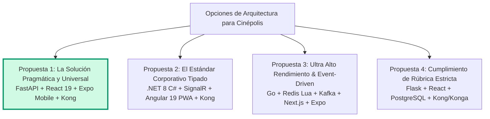

# 🎬 Propuestas de Arquitectura y Stack Tecnológico — Sistema Cinépolis (Web & Mobile)

Este documento presenta el análisis técnico formal de **cuatro propuestas arquitectónicas** para el sistema integral de Cinépolis (Cartelera, Asientos, Dulcería, Carrito/Pagos, Club Cinépolis y Workers de Scraping), adaptadas para operar tanto en plataforma **Web** como en aplicaciones **Móviles (iOS y Android)**.

---

## 📌 Contexto y Desafíos Críticos del Dominio

Un sistema de venta de boletos y dulcería para cines presenta desafíos únicos que condicionan la arquitectura:

1. **Concurrencia extrema en recursos compartidos:** El problema del "estreno masivo" (miles de usuarios intentando seleccionar los mismos asientos al mismo segundo). Exige reservas temporales atómicas sin doble venta.
2. **Asimetría de Lectura/Escritura:** 95% de tráfico en consulta de cartelera (lecturas intensivas) frente a un 5% de transacciones de compra (escrituras ACID estrictas).
3. **Sincronización Multiplataforma (Web + Móvil):** Clientes móviles con conexiones intermitentes, requerimientos de boletos offline (códigos QR sin internet), pagos de un toque (Apple Pay / Google Pay) e integración con Apple Wallet y Google Wallet.

---

## 🏗️ Resumen de las 4 Propuestas Evaluadas



---

### Propuesta 1: ⭐ La Solución Pragmática y Universal (RECOMENDADA)
> **Enfoque:** Monorepo Universal (React + Expo) con Backend FastAPI existente desacoplado vía Kong Gateway y acelerado por Redis.

* **Frontend Web:** React 19 + TypeScript + Vite + TailwindCSS (código actual).
* **Frontend Móvil:** React Native con Expo SDK (compartiendo el 70% del código: tipos, stores Zustand y hooks TanStack Query).
* **API Gateway:** Kong Gateway + Konga Admin GUI (enrutamiento unificado `/api/v1`, CORS, Rate Limiting y métricas).
* **Backend Core:** Python FastAPI + Uvicorn (los 24 endpoints y 8 controladores actuales se conservan al 100%).
* **Caché y Bloqueo Concurrente:** Redis (para bloquear asientos temporales con TTL de 10 min en < 1ms).
* **Base de Datos:** PostgreSQL 15+ (esquema `secret_wars` existente).
* **Workers:** Python + Playwright (scrapers y enriquecimiento de datos de cartelera desacoplados).
* **Monitoreo Sintético:** Uptime Kuma + Bots sintéticos periódicos con Playwright.

---

### Propuesta 2: El Estándar Corporativo Tipado (.NET 8 Enterprise + Angular 19 Web)
> **Enfoque:** Robustez empresarial, tipado estricto de punta a punta, WebSockets nativos con SignalR y UI reactiva sin Virtual DOM (*Signals*). 100% Web con soporte PWA (sin aplicación móvil nativa).

* **Frontend Web:** Angular 19 (Standalone Components, Signals, Zoneless, SSR / Hydration) + TailwindCSS.
* **Soporte Móvil (Web):** Progressive Web App (PWA) con Service Workers para instalación en pantalla de inicio y visualización de boletos QR offline.
* **API Gateway:** Kong Gateway + Konga Admin GUI (enrutamiento `/api/v1`, CORS, Rate Limiting y terminación SSL).
* **Backend Core:** C# (.NET 8 ASP.NET Core Web API) + SignalR (WebSockets nativos para el mapa de salas) + Dapper (micro-ORM para consultas SQL ultrarrápidas).
* **Caché y Bloqueo Concurrente:** Redis (Distributed Locks para reservas de asientos con TTL de 10 min).
* **Base de Datos:** PostgreSQL 15+ (esquema `secret_wars` existente).
* **Workers:** Python (Playwright para scraping de cartelera) desacoplados.
* **Monitoreo:** Prometheus + Grafana + Blackbox Exporter.

---

### Propuesta 3: Ultra Alto Rendimiento y Event-Driven (Nivel Ticketmaster / Cinépolis Corporativo)
> **Enfoque:** Desacoplamiento total con microservicios asíncronos y latencias sub-milisegundo.

* **Frontend Web:** Next.js 15 (React 19) con Server Components (SEO instantáneo para películas).
* **Frontend Móvil:** React Native Expo.
* **Tiempo Real / Ticketing Engine:** Go (Golang) para el motor de reserva de salas y WebSockets concurrentes (100k conexiones por nodo).
* **Gestión de Asientos:** Redis Stack con Scripts Lua atómicos en memoria RAM.
* **Bus de Mensajería:** Apache Kafka o RabbitMQ (eventos de orden pagada, puntos de lealtad y generación de tickets asíncronos).
* **Servicios Auxiliares:** Python FastAPI para Dulcería y Workers de Scraping; Node.js para Club Cinépolis.
* **Base de Datos:** PostgreSQL con Réplicas de Lectura.
* **Monitoreo:** OpenTelemetry + Grafana Mimir/Loki.

---

### Propuesta 4: Cumplimiento de Rúbrica Estricta (Flask Clásico)
> **Enfoque:** Cumplir al pie de la letra con el listado original de tecnologías manteniendo el esfuerzo acotado.

* **Frontend Web:** React 19 + TypeScript + Vite.
* **Frontend Móvil:** PWA móvil o app básica en React Native.
* **API Gateway:** Kong Gateway + Konga.
* **Backend:** Python Flask (migrando los controladores de FastAPI a Flask Blueprints).
* **Base de Datos:** PostgreSQL.
* **Monitoreo:** Uptime Kuma (Monitoreo Sintético de salud HTTP/TCP).

---

## 📊 Matriz Comparativa de Decisiones

| Criterio de Evaluación | Propuesta 1 (Pragmática FastAPI + Expo) ⭐ | Propuesta 2 (.NET 8 C#) | Propuesta 3 (Go + Event-Driven) | Propuesta 4 (Flask Estricta) |
| :--- | :---: | :---: | :---: | :---: |
| **Tiempo de Salida a Producción** | 🚀 **Inmediato (1-2 semanas)** | ⏱️ 3-4 semanas | ⏳ 6-8 semanas | ⏱️ 2-3 semanas |
| **Riesgo de Regresiones / Bugs** | 🟢 **Mínimo (código probado)** | 🟡 Medio (reescritura API) | 🔴 Alto (arquitectura distribuida) | 🟡 Bajo-Medio |
| **Reutilización de Código Web/Móvil** | 🏆 **70% (Monorepo Turborepo)** | 🌐 **100% Web (PWA unificada)** | 🟢 60% | 🟡 30% |
| **Rendimiento en Concurrencia de Salas** | 🟢 **Excelente (con Redis)** | 🚀 Superior (SignalR + Angular Signals) | 🏆 Insuperable (Go + Lua) | 🟡 Moderado |
| **Facilidad de Mantenimiento** | 🟢 **Muy Alta** | 🟢 Alta (Tipado estricto C# + TS) | 🔴 Compleja | 🟢 Alta |
| **Capacidades Móviles Nativas** | 🏆 **Completas (Apple Wallet, Offline QR)**| 🟢 **PWA (Instalable, QR Offline)** | 🏆 **Completas** | 🟡 Limitadas |
| **Costo de Infraestructura** | 💵 **Bajo (1 servidor / Docker)** | 💵 Bajo | 💵💵 Medio-Alto (Kafka, Clúster) | 💵 Bajo |

---

## 🏆 Veredicto: ¿Por qué la PROPUESTA 1 es la más recomendada?

La **Propuesta 1 (FastAPI + React 19 + Expo Mobile + Kong Gateway + Redis)** es la ganadora indiscutible por cuatro razones estratégicas:

```
                               ┌────────────────────────────────────────────────────────┐
                               │                    POR QUÉ GANA LA                     │
                               │                 PROPUESTA 1 (PRAGMÁTICA)               │
                               └───────────────────────────┬────────────────────────────┘
                                                           │
        ┌───────────────────────────────────┬──────────────┴────────────────────┬───────────────────────────────────┐
        ▼                                   ▼                                   ▼                                   ▼
┌──────────────────────┐        ┌──────────────────────┐        ┌──────────────────────┐        ┌──────────────────────┐
│  REUTILIZACIÓN 70%   │        │     CERO RIESGO      │        │  TIEMPO REAL NATIVO  │        │   EXPERIENCIA APP    │
│  Zustand, TanStack y │        │  Tus 24 endpoints y  │        │  Con Redis locks, el │        │  Apple Wallet, QR    │
│  TypeScript comparti-│        │  consultas SQL de BD │        │  mapa de salas opera │        │  offline, FaceID y   │
│  dos entre Web y App │        │  quedan intactos al  │        │  en sub-milisegundos │        │  detección de cine   │
│  con React + Expo.   │        │  100% sin reescribir.│        │  sin duplicar ventas.│        │  por GPS integrados. │
└──────────────────────┘        └──────────────────────┘        └──────────────────────┘        └──────────────────────┘
```

---

## 📐 Arquitectura en Detalle de la Propuesta Ganadora

```mermaid
flowchart TD
    subgraph Clients[" Clientes Multiplataforma "]
        Web["🖥️ Web App (React 19 + Vite)<br/>Zustand + TanStack Query"]
        Mobile["📱 App Móvil iOS / Android (React Native Expo)<br/>Apple Pay, Push Notifications, QR Offline"]
    end

    subgraph Gateway[" Capa de API Gateway (Kong & Konga) "]
        Kong["🦍 Kong Gateway (:8000)<br/>• Enrutamiento versionado (/api/v1)<br/>• Rate Limiting (120 req/min por dispositivo)<br/>• CORS centralizado y SSL"]
        Konga["🎛️ Konga Admin GUI (:1337)"]
    end

    subgraph BackendCore[" Capa de Backend & Workers "]
        FastAPI["⚡ FastAPI Core Service (:8000 interno)<br/>Uvicorn ASGI Engine<br/>24 endpoints intactos"]
        RedisLock[("⚡ Redis Cache & Lock<br/>Bloqueo temporal de asientos (TTL 10 min)<br/>Caché de cartelera")]
        Scrapers["🕷️ Scraper & Enrichment Worker (Playwright)<br/>Ejecución batch independiente"]
    end

    subgraph Data[" Capa de Base de Datos "]
        PG[(🐘 PostgreSQL 15+)<br/>Esquema: secret_wars]
    end

    subgraph Monitoring[" Monitoreo Sintético "]
        Kuma["🤖 Uptime Kuma (:3001)<br/>Simulación sintética de compra cada 5 min"]
    end

    %% Conexiones
    Web -->|HTTP / REST| Kong
    Mobile -->|HTTP / REST| Kong
    Konga -->|Control API :8001| Kong

    Kong --> FastAPI
    FastAPI <--> RedisLock
    FastAPI --> PG
    Scrapers --> PG

    Monitoring -.->|Probes sintéticos| Kong
    Monitoring -.->|Health checks| FastAPI
```

---

## 🗺️ Hoja de Ruta para Implementación (Roadmap)

### Fase 1: Dockerización e Infraestructura Gateway (Días 1 - 2)
1. Empaquetar el backend actual de FastAPI en un `Dockerfile`.
2. Crear el archivo `docker-compose.yml` integrando:
   * `postgres` (Base de datos del negocio y del gateway).
   * `kong` + `konga` (API Gateway y panel web).
   * `fastapi-backend` (Expuesto solo internamente hacia Kong).
   * `uptime-kuma` (Monitoreo sintético proactivo).
3. Configurar la ruta `/api` en Konga apuntando a FastAPI.

### Fase 2: Configuración del Monorepo Web + Móvil (Días 3 - 5)
1. Inicializar la estructura con **Turborepo**:
   * Mover `cinepolis-frontend` a `apps/web`.
   * Crear `apps/mobile` con `npx create-expo-app`.
   * Extraer `src/types/api.ts` y las llamadas de `api/endpoints.ts` a un paquete compartido `packages/api-client`.
2. Conectar la app móvil al mismo endpoint de Kong Gateway (`http://<tu-ip>:8000/api/v1`).

### Fase 3: Capacidades Nativas y Optimizaciones (Días 6 - 8)
1. Integrar **Redis** para el bloqueo de asientos en memoria.
2. Implementar almacenamiento local del boleto con **MMKV/SQLite** en móvil para lectura de QR sin señal.
3. Activar el pase digital de **Apple Wallet / Google Wallet** para la confirmación de compra.

---

## 🏛️ Desglose Técnico Completo de la Propuesta 2 (Actualizada con Angular 19 Web & PWA)

Para comprender en profundidad cómo opera el stack corporativo tipado (.NET 8 + Angular 19) en un entorno estrictamente Web:

```mermaid
flowchart TD
    subgraph ClientLayer[" Capa de Cliente Web Unificada (100% Web) "]
        Angular["🅰️ Angular 19 Web App (Desktop & Mobile Browser)<br/>• Standalone Components & Signals (Zoneless)<br/>• SSR / Hydration para Cartelera instantánea y SEO<br/>• RxJS + @microsoft/signalr para Websockets<br/>• TailwindCSS para diseño responsivo"]
        PWA["📲 Service Worker & PWA Cache<br/>• Instalación en pantalla de inicio<br/>• Visualización de boletos QR Offline (Cache Storage API)"]
    end

    subgraph GatewayLayer[" Capa de API Gateway (Kong & Konga) "]
        Kong["🦍 Kong Gateway (:8000)<br/>• Enrutamiento API (/api/v1) y WebSockets Passthrough (/hub)<br/>• Rate Limiting estricto para preventas<br/>• CORS centralizado y terminación SSL"]
        Konga["🎛️ Konga Admin GUI (:1337)"]
    end

    subgraph BackendLayer[" Capa de Backend Corporativo (.NET 8 C#) "]
        DotNet["⚡ ASP.NET Core 8 Web API (:5000 interno)<br/>• Controladores REST tipados<br/>• FluentValidation para reglas de negocio<br/>• Dapper (Micro-ORM de ultra alto rendimiento)"]
        SignalRHub["📡 SignalR Hub (SalaHub)<br/>• Canales en tiempo real por función/sala<br/>• Transmisión de cambios de asiento en sub-milisegundos"]
        WorkerBG["⏱️ BackgroundService (.NET)<br/>• Limpieza y liberación automática de asientos expirados (TTL 10 min)"]
    end

    subgraph CacheLayer[" Caché Distribuido y Bloqueos "]
        Redis[("⚡ Redis Stack<br/>• Bloqueo atómico de asientos (SETNX / Distributed Lock)<br/>• Caché de cartelera y catálogos")]
    end

    subgraph DataLayer[" Capa de Base de Datos "]
        PG[(🐘 PostgreSQL 15+)<br/>Esquema: secret_wars<br/>Consultas optimizadas con Dapper]
    end

    subgraph ScrapersLayer[" Workers Desacoplados "]
        Scrapers["🕷️ Scraper Worker (Python + Playwright)<br/>Carga batch de cartelera y sinopsis"]
    end

    subgraph MonitoringLayer[" Observabilidad y Monitoreo "]
        Prom["📊 Prometheus (Métricas de .NET con prometheus-net)"]
        Grafana["📈 Grafana Dashboards (Latencia, Conexiones SignalR, Tráfico)"]
    end

    %% Flujos
    Angular <-->|HTTP REST / JSON| Kong
    Angular <-->|WebSocket SignalR| Kong
    PWA -.-> Angular
    Konga -->|Admin API| Kong

    Kong -->|Proxy REST| DotNet
    Kong -->|Proxy WebSocket| SignalRHub

    DotNet <--> Redis
    SignalRHub <--> Redis
    DotNet --> PG
    WorkerBG <--> Redis
    WorkerBG --> PG
    Scrapers --> PG

    Prom -.->|Scrape métricas| DotNet
    Grafana --> Prom
```

### Tabla de Tecnologías y Responsabilidades (Stack Propuesta 2)

| Capa | Tecnología | Versión | Rol / Responsabilidad en el Sistema |
| :--- | :--- | :--- | :--- |
| **Frontend Framework** | **Angular** | **19.x** | SPA corporativa con Standalone Components. Sin dependencias de Zone.js ni sobrecarga de Virtual DOM. |
| **Gestión de Estado UI** | **Angular Signals** | Nativo | Reactividad granular: actualiza únicamente el botón/asiento del DOM que cambió de estado. |
| **Tiempo Real (Cliente)** | **@microsoft/signalr** + **RxJS** | Oficial | Conexión WebSocket bidireccional gestionada como un `Observable`. Reconexión automática y manejo de errores. |
| **Renderizado & SEO** | **Angular SSR + Hydration** | 19.x | Renderiza en servidor la cartelera para carga en < 1 segundo y máxima indexación en buscadores. |
| **Capacidades Móviles** | **@angular/pwa** | Oficial | Service Workers para instalación en teléfonos móviles y visualización de boletos QR sin conexión a internet. |
| **Diseño / Estilos** | **TailwindCSS** | 4.x | Maquetación responsiva limpia tanto para monitores 4K de escritorio como para pantallas móviles. |
| **API Gateway** | **Kong Gateway + Konga** | 3.x | Punto de entrada único (`:8000`), Rate Limiting (anti-bots en estrenos), CORS y proxy de WebSockets. |
| **Backend Core** | **C# / .NET 8** (ASP.NET Core) | 8.0 LTS | Web API fuertemente tipada, altamente optimizada para procesamiento multihilo y concurrencia. |
| **Motor Tiempo Real** | **ASP.NET Core SignalR** | 8.0 LTS | Hub de WebSockets para salas (`SalaHub`). Multiplexa salas por grupos (`Groups.AddToGroupAsync`). |
| **Acceso a Datos** | **Dapper** | 2.1+ | Micro-ORM que mapea directamente consultas SQL a objetos C# con latencia sub-milisegundo (más rápido que EF Core). |
| **Caché y Locks** | **Redis** | 7.x | Bloqueos distribuidos de asientos con TTL de 10 min para evitar venta doble en el mismo segundo. |
| **Base de Datos** | **PostgreSQL** | 15+ | Almacenamiento relacional ACID (`secret_wars`). |
| **Workers** | **Python + Playwright** | 3.11+ / 1.58+ | Scraping y enriquecimiento de cartelera desacoplado que alimenta PostgreSQL en background. |
| **Monitoreo** | **Prometheus + Grafana** | Latest | Monitoreo de latencia HTTP, conexiones activas de SignalR y consumo de memoria. |


